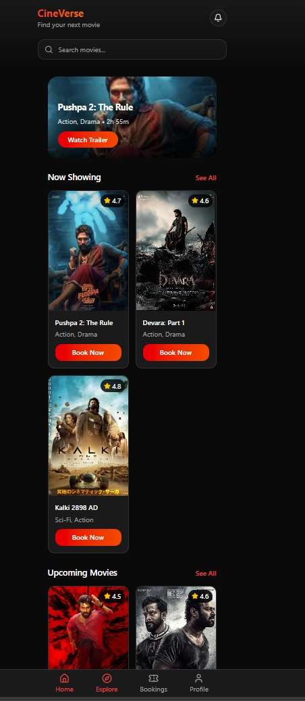
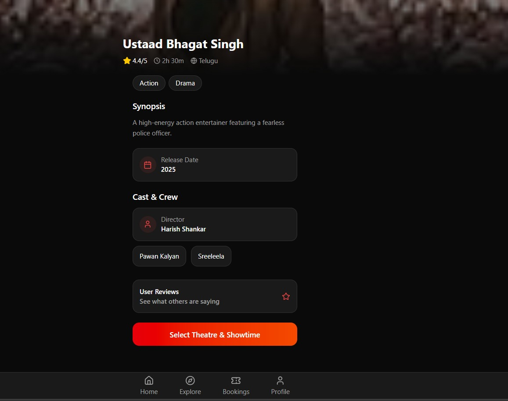
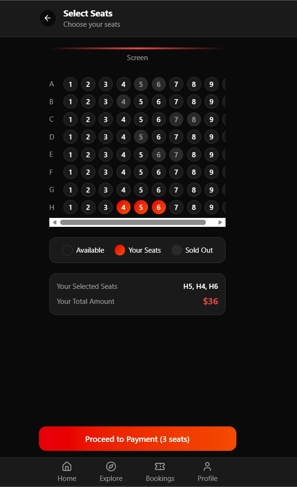
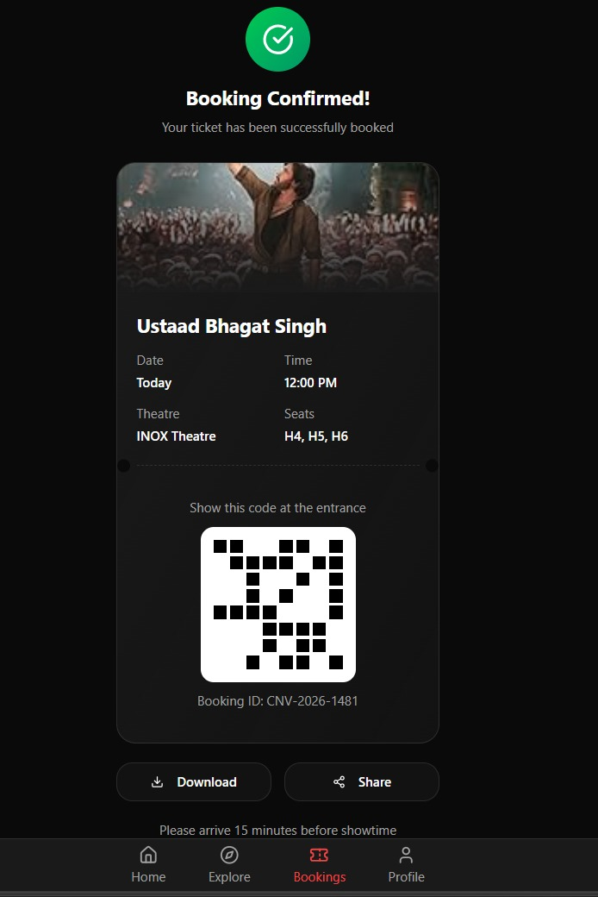

# CineVerse — Full-Stack Movie Ticket Booking Platform

[](https://react.dev/)
[](https://www.typescriptlang.org/)
[](https://vite.dev/)
[](https://mui.com/)
[](https://tailwindcss.com/)
[](https://movie-booking-app-virid.vercel.app/login)

A modern, responsive movie ticket reservation web application developed for the **APPTHETICS 3.0 Hackathon**. Provides a streamlined cinema booking workflow with dynamic seat selection matrices, shopping cart state management, and an adaptive mobile-first design.

---

## Live Prototype

Experience the live application here:  
**[movie-booking-app-virid.vercel.app](https://movie-booking-app-virid.vercel.app/login)**

---

## Key Features

- **Movie Discovery & Catalog**: Search, browse, and filter trending films and upcoming releases with genre tags and critic ratings.
- **Dynamic Seat Selection Matrix**: Interactive grid allowing patrons to choose specific seats, view real-time pricing tiers, and prevent duplicate selections.
- **Persistent Cart & Checkout Workflow**: Seamless state handling managing selected cinema tickets, concessions, showtimes, and total invoice calculations.
- **Mobile-First Responsive Interface**: Optimized for tactile touch input across smartphones, tablets, and desktop displays.
- **Modular Component Architecture**: Decoupled UI components built with Radix UI, Material UI, and Tailwind CSS.

---

## Tech Stack

- **Frontend Core**: React 18, TypeScript, Vite
- **UI Frameworks & Styling**: Material UI, Tailwind CSS, Radix UI primitives, Lucide Icons, Emotion
- **State Management & Forms**: React Hook Form, Custom Context API
- **Animations & Visuals**: Motion, Canvas Confetti
- **Deployment**: Vercel

---

## Screenshots

| Home Catalog | Featured Movie Details |
| :---: | :---: |
|  |  |

| Interactive Seat Matrix | Booking Summary |
| :---: | :---: |
|  |  |

---

## Project Structure

```
movie-booking-app/
├── assets/                 # Photographic screenshots & UI preview assets
├── guidelines/             # Design and hackathon specifications
├── src/
│   ├── components/         # Reusable UI widgets (seat matrix, navigation, cards)
│   ├── screens/            # Application views (Home, MovieDetail, Booking, Checkout)
│   ├── App.tsx             # Root component and client routing
│   └── main.tsx            # Vite entrypoint
├── server/                 # Mock server & API utilities
├── index.html              # HTML shell
├── package.json            # Node.js dependencies & scripts
├── vite.config.ts          # Vite build configuration
└── README.md               # Technical documentation
```

---

## Getting Started

### Prerequisites

- Node.js (v18.x or v20.x recommended)
- npm or pnpm

### Local Installation

1. **Clone the repository:**
   ```bash
   git clone https://github.com/pratapashanmukhi/movie-booking-app.git
   cd movie-booking-app
   ```

2. **Install dependencies:**
   ```bash
   npm install
   ```

3. **Start the development server:**
   ```bash
   npm run dev
   ```

4. **Open in browser:**
   Navigate to `http://localhost:5173`.

---

## Future Roadmap

- Payment gateway integration (Stripe / Razorpay).
- Multi-theater and multi-language screening schedules.
- Social group booking with split payment links.
- AI-driven personalized film recommendations based on viewing history.

---

## Authors & Hackathon Team

- **Shanmukhi Pratapa** ([@pratapashanmukhi](https://github.com/pratapashanmukhi))
- **Shaik Jakeera**
- **Vyshnavi**
